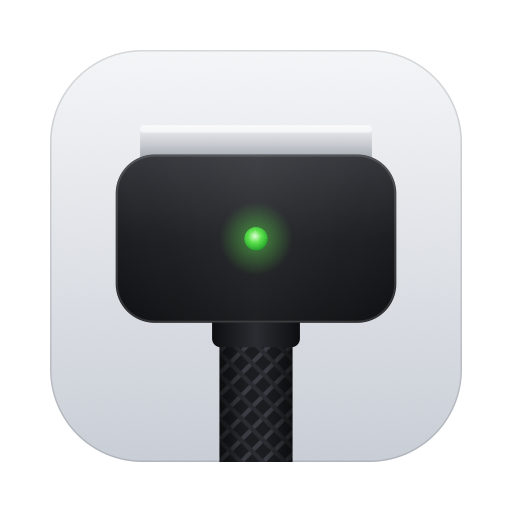
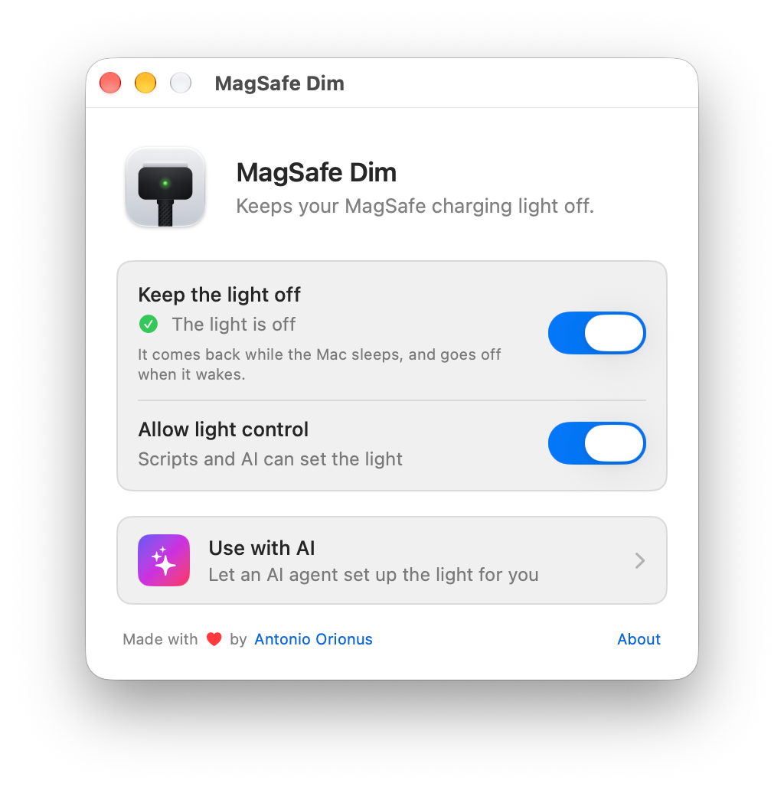

<div align="center">
  
  <h1>MagSafe Dim</h1>
  <p>Keeps your MagSafe charging light off.<br><br>
  <a href="https://github.com/antonio-orionus/magsafe-dim/releases/latest/download/MagSafe-Dim.dmg"><b>Download for macOS</b></a><br>
  <sub>MacBooks with MagSafe 3 · macOS 13 or later</sub></p>
</div>

<p align="center">
  <picture>
    <source media="(prefers-color-scheme: dark)" srcset="assets/screenshots/window-dark.png">
    
  </picture>
</p>

MagSafe Dim is a free, open-source macOS app that turns off the charging LED on a
MacBook's MagSafe 3 connector and turns it off again after every plug-in and wake.
One switch: no menu bar icon, no charge limit, nothing else to set up.

## Install

Download [MagSafe-Dim.dmg](https://github.com/antonio-orionus/magsafe-dim/releases/latest/download/MagSafe-Dim.dmg),
open it and drag MagSafe Dim to Applications, then open it from there. Turn on
**Keep the light off**, and allow it once when macOS asks: click its notification, or
turn on MagSafe Dim in System Settings › General › Login Items, then enter an
administrator password.

Works on MacBooks with a MagSafe 3 port: MacBook Pro 14-inch and 16-inch (2021 and
later) and MacBook Air (M2 and later).

## Uninstall

Turn the switch off, then move the app to the Trash. (Trashing it while the switch is on
also gives the light back within a few minutes, but leaves an entry in Login Items.)

## Good to know

The light comes back while the Mac sleeps, and goes off again when it wakes.

## License

MIT. See [LICENSE](LICENSE).

<details>
<summary><b>Technical details</b></summary>

### Build from source

Needs Rust and the Xcode Command Line Tools.

```sh
git clone https://github.com/antonio-orionus/magsafe-dim
cd magsafe-dim
scripts/build-app.sh
open "target/MagSafe Dim.app"      # it offers to move itself to Applications
```

`scripts/build-app.sh` signs the app ad-hoc, which is enough on your own Mac. With a
Developer ID, set `SIGN_IDENTITY="Developer ID Application: Your Name (TEAMID)"`, so
Login Items lists it under your name. Add `NOTARY_PROFILE=<profile>`, a profile saved with
`xcrun notarytool store-credentials`, to notarize and staple the app, then build, sign,
notarize and staple `target/MagSafe-Dim.dmg` for download (with
[dmgbuild](https://github.com/dmgbuild/dmgbuild), run through `uvx`). `OUT_DIR=target/dev` puts the app elsewhere. Run it
as yourself, not with `sudo`, so `codesign` can use the key in your login keychain.

### How the app is put together

```
MagSafe Dim.app/Contents/
  MacOS/MagSafe Dim                 the window (SwiftUI, app/)
  MacOS/magsafe-dim                 the helper (Rust, src/), runs as `magsafe-dim run`
  Library/LaunchDaemons/dev.orionus.magsafe-dim.daemon.plist
  Resources/AppIcon.icns
```

The switch registers or unregisters the helper with Apple's `SMAppService`, which runs
it from inside the app as a launchd daemon. The window shows the light by running
`magsafe-dim led`, which reads it without root. From a terminal:

```sh
"/Applications/MagSafe Dim.app/Contents/MacOS/magsafe-dim" status   # light and helper state
sudo "/Applications/MagSafe Dim.app/Contents/MacOS/magsafe-dim" run # foreground (switch the app off first); Ctrl-C gives the light back
log show --last 1h --predicate 'process == "magsafe-dim"'
```

### What it touches

- **One SMC key, `ACLC`** (the LED), and nothing else. Before every read or write
  the helper checks that the key exists and is a one-byte `ui8 ` key, and refuses
  otherwise.
- **Two values only:** `0x01` (off) while it runs, `0x00` (macOS decides) when it
  stops. The write function takes an enum with just those two values, so nothing
  else can reach the SMC.
- **Writes only on a mismatch.** Most events cost one read.
- **Never delays sleep** and never keeps the Mac awake. It changes no charging
  behaviour, power setting or file.
- **Dependencies:** `objc2-io-kit` and `objc2-core-foundation` (bindings to Apple's
  frameworks) and `libc` for the helper; Apple's SwiftUI and ServiceManagement for
  the window. Nothing else.

### How it works

macOS and the SMC rewrite `ACLC` on power events, so the daemon waits for them on a
CoreFoundation run loop and turns the LED off again:

| Event | Source | Check |
|---|---|---|
| plug-in, unplug | `IOPSCreateLimitedPowerNotification` | every 250 ms for 5 s |
| charge state, battery level, dark wakes | `IOPSNotificationCreateRunLoopSource` | once |
| wake from sleep | `IORegisterForSystemPower` | every 250 ms for 5 s |
| missed event; app updated or deleted | timer | once a minute |

The 5-second checks are needed because after a plug-in or wake the SMC resets the
LED in short bursts and ignores writes meanwhile. If an SMC call fails (the
connection can go stale across sleep), it reopens the connection and tries once more.
`SIGTERM` (when the switch turns it off), `SIGINT` and `SIGHUP` write `0x00` and exit.

Once a minute the helper also checks its own file. When the app was updated with a copy
signed like the running one (same Developer ID), it exits and launchd starts the new copy
at once. A copy signed any other way is left alone until the next start, so the root
helper never hurries into running a file someone else put there. When the app has been
missing for three minutes in a row, it gives the light back to macOS and stops.

### Limits

- **The LED comes back on while the Mac sleeps.** A few seconds into sleep the Mac
  renegotiates USB-C power with the charger (20 V → 5 V), and the SMC treats that
  like a fresh plug-in. Nothing can run during sleep to undo it. The daemon turns
  the LED off again on each wake, including the short maintenance wakes.
- **A short green flash on plug-in**, while the SMC ignores writes.
- **`ACLC` is undocumented.** A macOS or firmware update could change or lock it.
  The daemon then logs one error and does nothing, and the LED behaves as stock.

If you need it dark during sleep too, charge through a USB-C port with a plain
USB-C cable (no LED at all), or cover the LED.

Tested on: MacBook Pro M5 Pro (Mac17,8), macOS 27.2.1, firmware 20457.41.3.

### Other tools (surveyed November 2026)

Every tool found writes the same `ACLC` key, and none keeps the LED off during sleep.

| Tool | License | What it is |
|---|---|---|
| [batt](https://github.com/charlie0129/batt) | GPL-2.0 | Charge limiter with `magsafe-led always-off`; sets an 80 % limit by default |
| [AlDente Pro](https://apphousekitchen.com/) | proprietary | Paid charge limiter with an LED setting |
| [markschlosser/magled](https://github.com/markschlosser/magled) | MIT | C daemon, events only; the closest to this one |
| [bulava92/magsafe-dark](https://github.com/bulava92/magsafe-dark) | MIT | Menu bar app and root daemon; polls every 15 s |
| [great-andy/MagSafeLed](https://github.com/great-andy/MagSafeLed) | GPL-3.0 | ObjC++ daemon; suggests preventing sleep on power for a dark LED in sleep |
| [realAbitbol/MagSleep](https://github.com/realAbitbol/MagSleep) | MIT | Swift menu bar app and daemon; 3 s timer |
| [gbretas/glowless](https://github.com/gbretas/glowless) | MIT | C daemon; polls every 2 s |
| [rolandsuu/ChargeKeeper](https://github.com/rolandsuu/ChargeKeeper) | MIT | Charge limiter with LED control |
| [shaoya828/magled](https://github.com/shaoya828/magled) | MIT | Swift app and helper; [a fork](https://github.com/zjhenrynsyh/magled) has macOS 27 fixes |
| [mpopv/magsafe-cli](https://github.com/mpopv/magsafe-cli) | MIT | Also dims the cable's own LED through its firmware (one cable firmware tested) |

### LED values

| `ACLC` | LED |
|---|---|
| `00` | macOS decides (reads back as its current choice) |
| `01` | off |
| `03` | green |
| `04` | amber |
| `05`–`07` | amber, blinking patterns |

The values come from batt and magled, which agree. The SMC user-client struct and
selectors match smcFanControl's `smc.c` and batt's gosmc.

### Development

```sh
cargo fmt --check && cargo clippy --all-targets -- -D warnings && cargo test
scripts/preview-ui.sh     # the window in every state, dark and light: target/ui-preview/*.png
scripts/build-app.sh      # the whole app, ad-hoc signed
```

`preview-ui.sh` draws the window offscreen, so design changes need no signing, no
install and no running helper. To test the first-run approval, use a fresh macOS VM:
macOS remembers approvals, so a Mac that has allowed MagSafe Dim before won't ask again.

The icon is drawn in [`assets/icon.svg`](assets/icon.svg) and the disk image window's
background in [`assets/dmg-background.svg`](assets/dmg-background.svg); its layout is in
[`scripts/dmg-settings.py`](scripts/dmg-settings.py). After editing an SVG, run
`assets/build-icon.sh`, which renders `AppIcon.icns`, `icon.png` and
`dmg-background.tiff` with macOS's own SVG support, and commit the SVG with its output.

</details>
